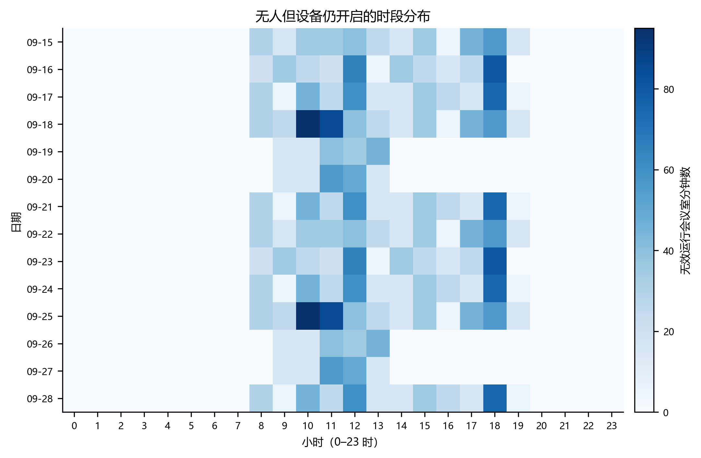
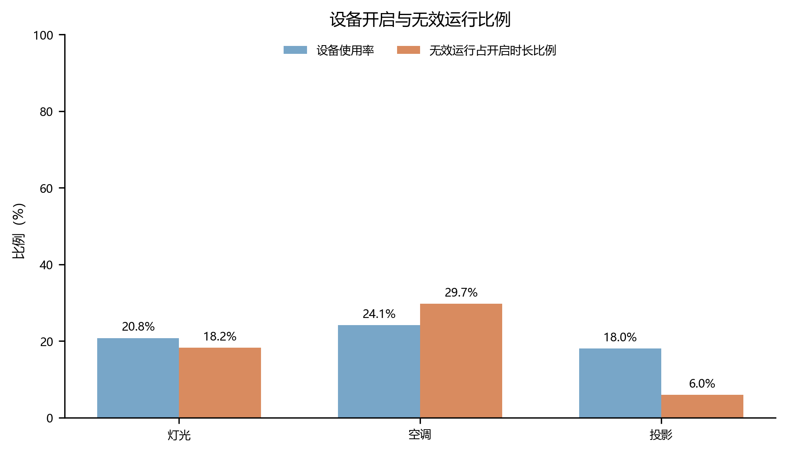
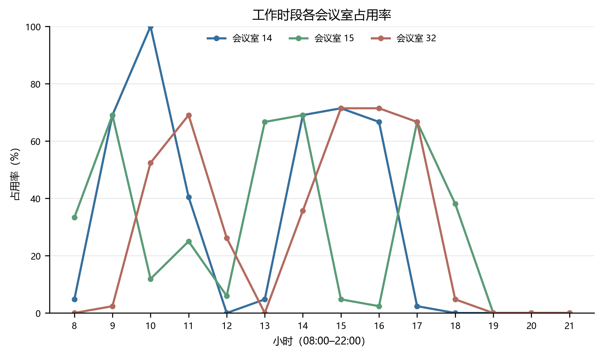
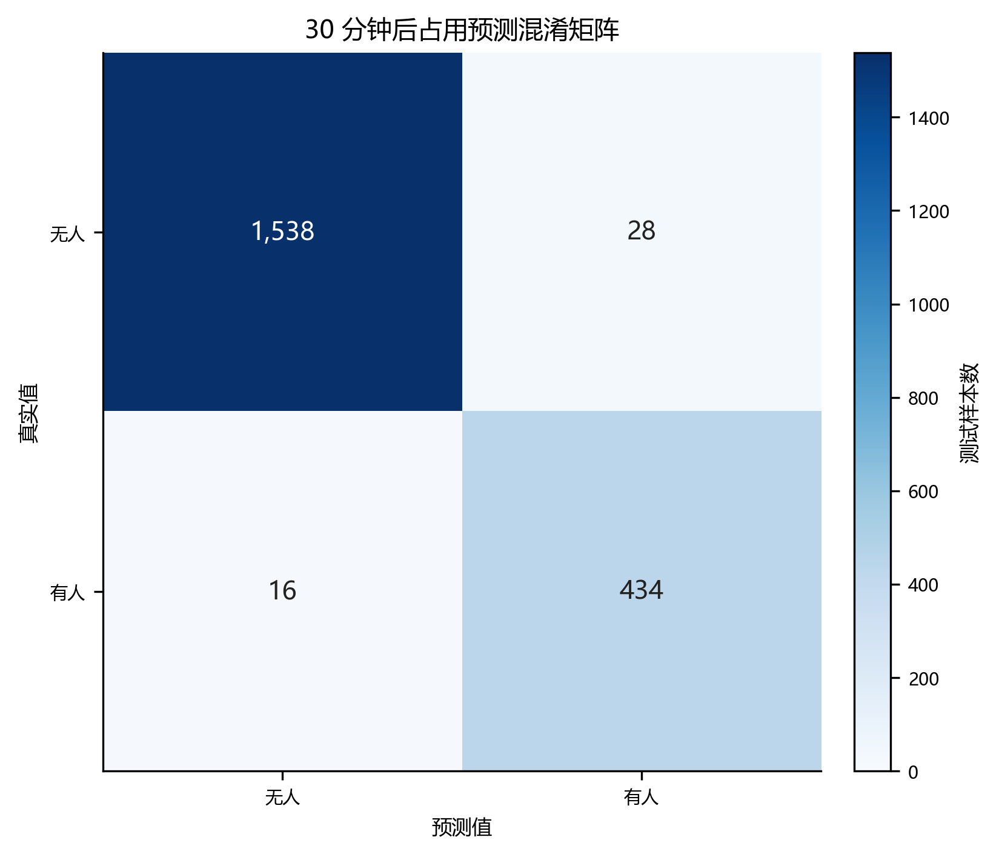

# 第 4 周数据分析与基线结果

## 数据范围

- 数据性质：教学模拟数据，`data_mode=simulated`。
- 时间范围：2026-09-15 00:00:00 至 2026-09-28 23:55:00。
- 规模：12096 条记录，3 个会议室，每 5 分钟采样一次。
- 设备分析有效样本：12090 条。

## 主要结论

- **无效运行峰值：2026-09-18 10:00。** 该小时累计 95 个会议室分钟存在无人但设备仍开启。
- **无效运行比例最高设备：空调。** 无人开启占该设备全部开启时长的 29.7%（4340 分钟）。
- **占用率峰值：会议室 14 10:00。** 08:00–22:00 口径下占用率为 100.0%，样本量 n=168。

## 图表结果

### 图 1 无人但设备仍开启的时段分布



- 口径：每个日期和小时内，occupancy=false 且至少一个设备开启的 5 分钟会议室时段累计分钟数。
- 数字结论：峰值出现在 2026-09-18 10:00，累计 95 个会议室分钟。

### 图 2 设备开启与无效运行比例



- 口径：使用率=开启样本数÷有效样本数；无效运行比例=无人时开启分钟数÷全部开启分钟数。
- 数字结论：空调的无效运行比例最高，为 29.7%，对应 4340 分钟。

### 图 3 工作时段各会议室占用率



- 口径：08:00–22:00 内按会议室和小时统计，occupancy=true 的采样数÷occupancy 有效采样数。
- 数字结论：最高点为 会议室 14 10:00，占用率 100.0%，n=168。

### 图 4 30 分钟后占用预测混淆矩阵



- 口径：测试集按时间后置切分；行是真实占用，列是预测占用，样本限定为 08:00–22:00。
- 数字结论：测试集 n=2016，准确率 97.8%，F1 95.2%。

## 基线预测

- 任务：使用当前及历史时段信息，预测 30 分钟后会议室是否有人。
- 切分：训练集 2026-09-15 至 2026-09-24，n=5040；测试集 2026-09-25 至 2026-09-28，n=2016。
- 主要指标：准确率 97.8%，F1 95.2%，平衡准确率 97.3%。
- 对照：直接用当前占用状态预测 30 分钟后的持久性基线，准确率 88.7%，F1 74.7%。
- 混淆矩阵：TP=434、TN=1538、FP=28、FN=16。
- 解释：该结果只验证数据到模型到展示的技术链路；输入为模拟数据，不代表真实部署效果。

## 可复现方式

```powershell
python -m pip install -r scripts/requirements.txt
python scripts/run_week4.py
python -m unittest discover -s tests -p "test_*.py" -v
```

## 限制

- 当前数据由固定随机种子生成，data_mode=simulated，不能表述为真实传感器实测结论。
- 5 分钟采样只支持以 5 分钟为最小单位估计无效运行时长。
