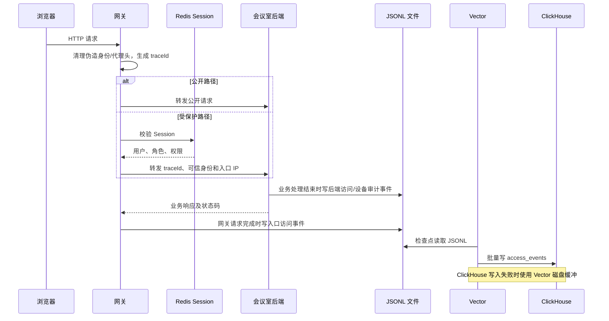
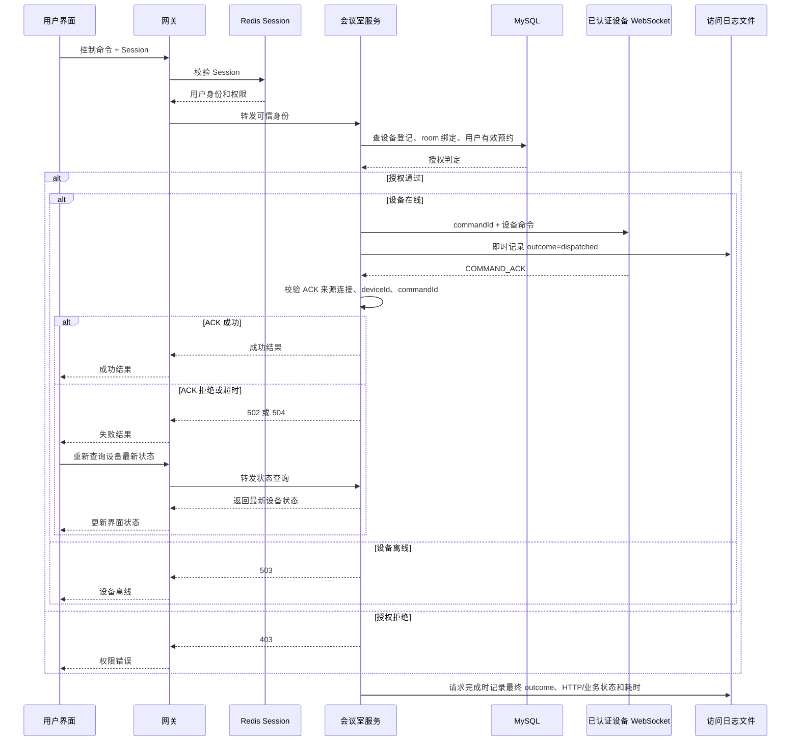
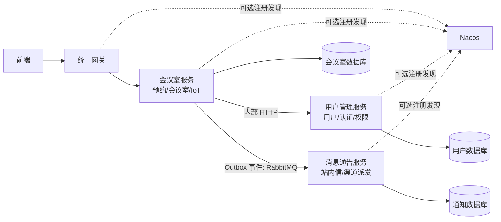
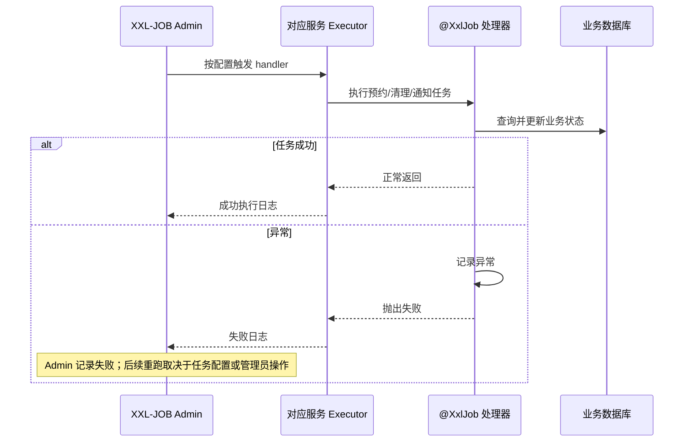
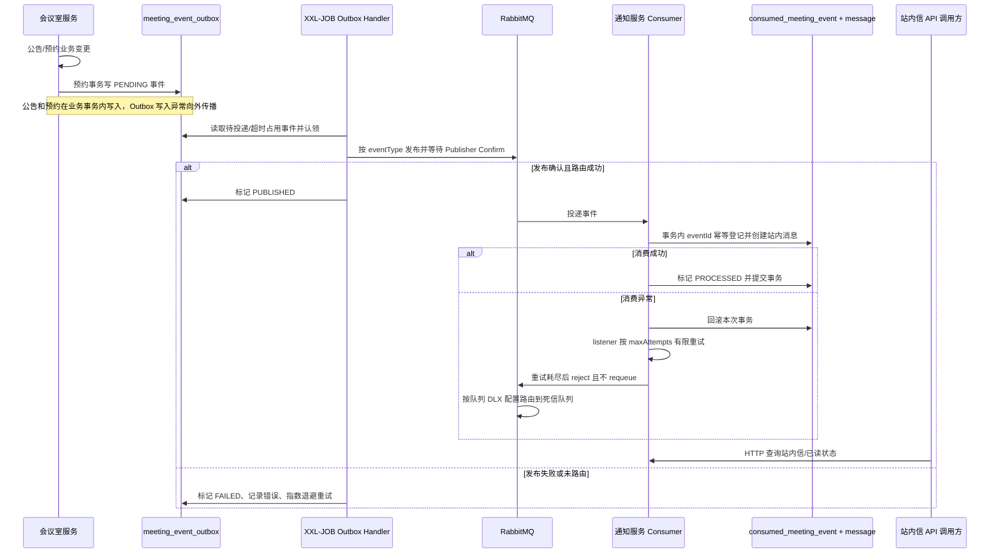
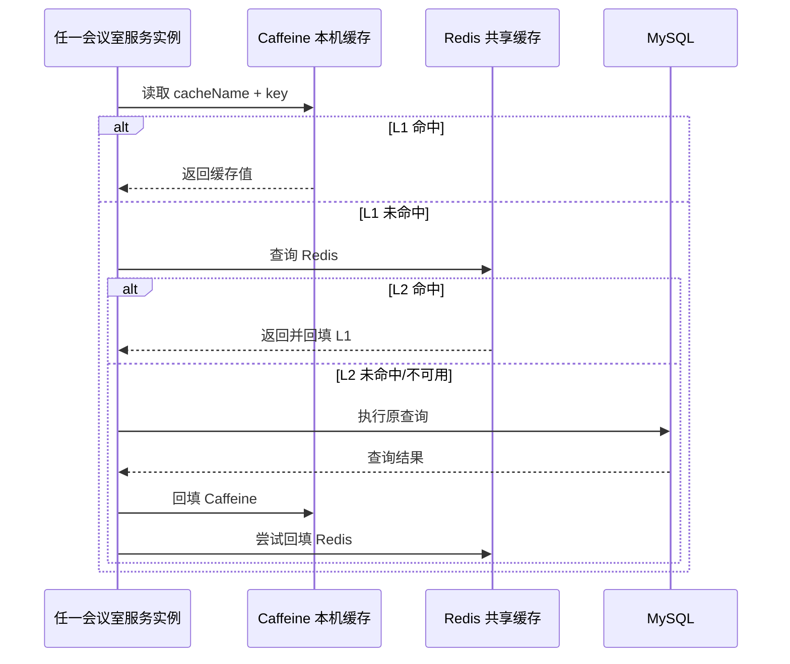
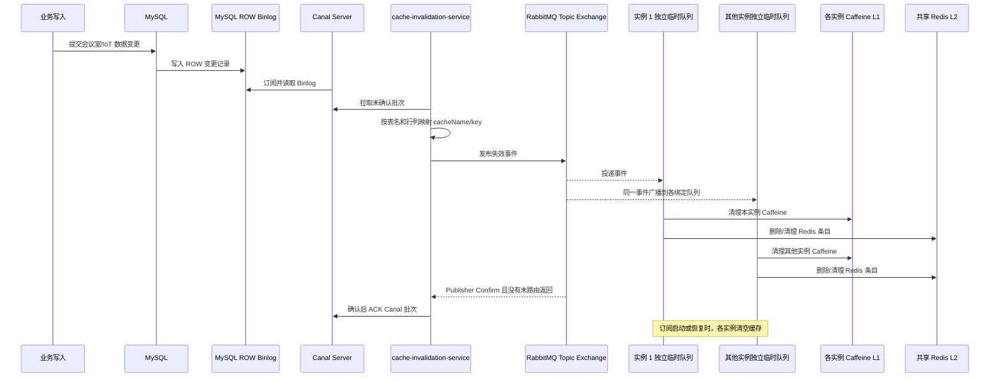

# ylshen 项目工作整理

> 本文按实际完成的工作项整理，不按周次分组。课程第 9—11 周要求仅用作工程化异常处理、功能集成和测试闭环的检查参考。

> 2026-11-09 已补充真实中间件集成测试与故障恢复，最新结论及实现修复见 [中间件集成验证记录](../integration-test-status.md)。历史测试条目仅代表当时范围。

## 工作范围

| 工作项 | 主要交付 | 代码/文档证据 |
| --- | --- | --- |
| 访问日志与审计 | 网关到后端的追踪、设备操作审计、Vector/ClickHouse 查询链路 | `49517cb`，`observability/`、`log-service/` |
| 设备安全与控制 | 设备认证、预约授权、ACK 校验、失败状态回读 | `49517cb`，`backend/`、`raspberry-pi/`、`frontend/` |
| 服务拆分与注册 | 独立用户管理服务、消息通告服务及 Nacos 配置 | `7e859d4`、`efc171d` |
| 定时任务治理 | 任务从 Spring 定时调度迁移至 XXL-JOB | `9c52578`，`deploy/xxl-job/` |
| 跨服务通知 | Outbox + RabbitMQ 传递公告、预约生命周期通知 | `fae6f7d`，`deploy/rabbitmq/` |
| 链路追踪 | 可选 SkyWalking OAP/UI 与 Java Agent 启动支持 | `9b9abf5`、`94fbbb2`，`deploy/skywalking/` |
| 缓存一致性 | Caffeine L1 + Redis L2，Canal Binlog 经 RabbitMQ 广播失效 | `60398aa`，`cache-invalidation-service/`、`deploy/canal/` |

提交作者在仓库记录为 `SYL <1160579753@qq.com>`；此处按用户说明对应 ylshen 整理。缓存双层与 Canal 部分已提交至当前 `ylshen` 分支。

## 访问日志与审计

**解决的问题**：请求经过网关、业务服务和设备控制后，原有日志难以串联；发生超时、拒绝或设备失败时，定位链路不便。

**实现与异常处理**：

- 网关生成 `X-Trace-Id` 并向后端传递；去除客户端提供的身份和代理来源头，再从可信 Session 注入身份。
- 网关和会议室后端写 JSONL 访问事件，包含时间、服务、路径、方法、状态码、耗时、用户编号、IP 和 trace ID。
- 设备命令关联设备、会议室、命令 ID、结果和异常；不记录请求体、Session、设备 token 或人脸图像/特征。
- Vector 以文件检查点和磁盘缓冲采集到 ClickHouse；日志服务只允许授权管理员查询，限制时间范围、分页大小和查询时间。
- 采集暂停时由 Vector 保留缓冲，恢复后续传；日志查询不可用时明确返回错误，不生成模拟记录。

### 日志数据结构

访问日志先以 JSONL 写入各进程的访问日志文件，再由 Vector 解析并写入 ClickHouse。没有额外的 MySQL 日志表；结构化分析表是 `meetingroom_logs.access_events`，字段如下：

| 字段 | ClickHouse 类型 | 默认值 | 含义 |
| --- | --- | --- | --- |
| `timestamp` | `DateTime64(3, 'UTC')` | 无 | 事件时间，UTC，毫秒精度 |
| `event_id` | `String` | 无 | 单条访问/设备事件的唯一编号 |
| `microservice` | `LowCardinality(String)` | 无 | 产生事件的服务名，如 `topbiz-gateway`、`meetingroom-main` |
| `api_endpoint` | `String` | 无 | HTTP 路径；设备下发事件记录控制接口路径 |
| `http_method` | `LowCardinality(String)` | 无 | HTTP 方法 |
| `status_code` | `UInt16` | 无 | HTTP 状态码 |
| `business_code` | `Int32` | 无 | 业务响应码；设备下发事件的该字段为 `1`，其 `status_code` 为 `202` |
| `latency_ms` | `UInt64` | 无 | 请求耗时毫秒；单独的设备下发事件当前为 `0` |
| `trace_id` | `String` | 无 | 网关生成并传递到后端的请求关联 ID |
| `user_id` | `String` | `''` | 由已验证会话解析的用户编号；匿名请求为空 |
| `client_ip` | `String` | `''` | 网关观察到的 TCP 对端 IP；后端事件使用网关传入的可信入口 IP |
| `user_agent` | `String` | `''` | 客户端 User-Agent |
| `device_id` | `String` | `''` | 设备编号；普通 HTTP 事件为空 |
| `room_id` | `String` | `''` | 会议室编号；仅有设备上下文时填写 |
| `command_id` | `String` | `''` | 设备命令唯一编号 |
| `outcome` | `String` | `''` | 设备命令阶段/结果，如 `dispatched`、`executed`、`ack_timeout` |
| `exception` | `String` | `''` | 异常类名，不包含堆栈或请求数据 |

表使用 `ReplacingMergeTree`，按 `timestamp` 月分区，排序键为 `(microservice, timestamp, event_id)`，TTL 为 30 天。查询使用 `FINAL` 读取合并后的结果。该引擎对相同排序键的重复写入提供最终去重；`event_id` 是排序键的一部分，所以不同 ID 的事件不会被合并。

日志链路如下。图示仅描述浏览器的 HTTP 请求；设备 WebSocket 握手/遥测走独立设备认证路径，不经过用户 Session 校验，也不由 HTTP 访问过滤器生成同类访问事件。网关在入口移除浏览器提供的 trace、身份和代理头，生成自己的 `X-Trace-Id`，将连接对端 IP 写入转发头；受保护 HTTP 路径再验证 Redis Session 并注入可信用户信息。后端沿用 trace ID 并写服务访问事件。设备控制审计字段由服务端上下文填入，不从客户端任意请求体复制。Vector 以文件检查点读取 JSONL，使用磁盘缓冲和 acknowledgements 投递；ClickHouse 暂不可用时先保留缓冲，恢复后续传。

### 日志字段来源和查询约束

网关在 `TraceLoggingFilter` 的请求链完成后写入口事件，服务端 IP 取 socket remote address；网关会清除客户端提供的 `X-Forwarded-For` 与 `X-Real-IP`，再设置由连接对端地址派生的入口 IP。后端 `AccessLogFilter` 在业务处理结束时写访问事件，早于网关收到后端响应并写入口事件。设备命令下发时还会即时写一条 `outcome=dispatched` 的独立事件；HTTP 请求最终结束时再由访问过滤器写带最终结果的事件。服务间共享的 `common-core` 过滤器供用户及通知服务复用 trace/MDC 和访问事件格式。`AccessLogResponseAdvice` 从统一 `Result` 提取业务码。会议室后端访问事件不保存查询参数；但 `common-core` 过滤器生成的用户/通知服务原始 JSONL 会记录 `query_string`。ClickHouse 表没有该列，Vector 配置 `skip_unknown_fields=true`，所以不会进入结构化表；本地原始日志文件仍可能保留查询参数，不能笼统说所有日志都不记录查询参数。链路不保存请求体、Cookie、Session、设备 token 或人脸图像/特征，异常只保存异常类名。

查询入口为 `POST /api/v1/logs/query`。`LogController` 每次从 Redis 重新读取 `SessionId`，仅允许 `room_admin` 和 `super_admin`；查询服务用参数绑定过滤服务名、trace、用户、设备、命令和状态码，时间区间最长 31 天、页大小最多 200、页号最多 10000，ClickHouse 查询超时 10 秒。日志服务不可访问 ClickHouse 时返回错误，不以空数据伪装成功。

**测试证据**：访问日志、网关过滤、日志查询和 ClickHouse 查询有自动化测试。已有本机采集记录为 50 次请求产生 75 条入口及后端事件；停止采集 60 秒后恢复，积压日志补齐。对应实施记录见 `ENGINEERING_PROGRESS.md`。

**主要位置**：`backend/src/main/java/com/uestcfir/logging/`、`topbiz-gateway/src/main/java/com/uestcfir/gateway/TraceLoggingFilter.java`、`log-service/`、`observability/`。

## 设备安全与控制

**解决的问题**：避免客户端伪造身份控制设备，避免用户越过预约权限控制其他会议室，并正确处理设备断线、回执错误和超时。

**实现与异常处理**：

- 网关校验 Redis Session，剥离浏览器身份头后注入可信身份；日志查询额外验证 Session 并限制管理角色。
- 树莓派通过设备编号和独立 token 握手；设备必须预先登记并绑定会议室。
- 每次控制重新检查设备绑定和当前有效预约，权限不缓存；服务端时间使用 `Asia/Shanghai`。
- ACK 必须来自发送命令的同一连接且设备编号匹配。失败、设备离线、超时分别返回错误状态；前端不把失败显示为成功，而是回读设备状态。
- 硬件不支持的操作不伪装成已执行；树莓派直连控制入口关闭，避免绕过后端权限。

### 设备授权和命令闭环

每次控制都会重新读取设备和预约关系，不缓存授权结果；普通用户须有该会议室当前有效预约，管理角色仍需具备设备控制权限且设备有效绑定。设备通过独立 token 握手后才能建立 WebSocket。服务端把命令挂到目标设备连接，ACK 必须来自原连接且设备编号匹配；错误回执、离线和超时分别形成明确失败结果，前端失败后刷新设备状态，不将失败渲染为成功。审计上下文记录授权结果、设备、会议室和命令结果。异常场景的自动化及模拟设备测试已覆盖，真实硬件逐条验收仍未完成。

**角色与数据访问**：

| 角色 | 权限范围 |
| --- | --- |
| 普通用户/预约人 | 查询本人预约和消息；仅在有效预约时控制对应会议室设备 |
| 会议室管理员/审批人 | 管理会议室和审批预约；在授权范围内控制设备；授权管理员可以查询审计日志 |
| 设备端 | 只能用自己的设备身份上报数据并接收已授权命令 |

人脸识别数据仅供树莓派识别流程使用，不进入访问日志。日志不记录人脸图像/特征、Session 或设备 token；日志查询服务限制为管理员角色。

**测试证据**：`IotControlAuthorizationServiceTest`、`ReservationPermissionSqlTest`、`DeviceHandshakeTest`、`CommandAcknowledgementTest`、`GatewayFiltersTest`；树莓派 `test_command_security.py`；前端 `control-smoke.mjs` 覆盖错误回执、超时、不重复下发、状态回读及切换会议室权限。

**主要位置**：`backend/src/main/java/com/uestcfir/service/IotControlAuthorizationService.java`、`backend/src/main/java/com/uestcfir/config/DeviceHandshakeInterceptor.java`、`backend/src/main/java/com/uestcfir/websocket/IotDeviceWebSocketHandler.java`、`topbiz-gateway/src/main/java/com/uestcfir/gateway/SessionAuthenticationFilter.java`、`raspberry-pi/`、`frontend/tests/control-smoke.mjs`。

## 服务拆分与注册

**解决的问题**：用户和通知业务与会议室核心服务耦合，不利于独立维护、部署及明确数据归属。

**实现**：拆分 `user-service` 和 `notification-service`，保留会议室后端，通过内部 API/服务发现协作；新增 Nacos 部署配置和服务名配置。用户库、通知库与会议室库分开，通知服务提供 HTTP 消息列表和已读接口。

**测试/运行证据**：三个服务各自具备独立配置与构建入口；本地 URL 与 Nacos 服务名可通过环境配置切换。部署关系和端口见 `services/README.md`。运行中的多机 Nacos 环境验收需由部署环境提供证据。

**主要位置**：`user-service/`、`notification-service/`、`platform-services/`、`deploy/nacos/`、`services/README.md`。

### 服务调用关系与数据边界

用户身份映射在用户服务，会议室库保留旧用户 ID 以兼容已有预约；通知服务负责自己的 `message`、模板、渠道和派发状态。会议室服务通过内部 HTTP 解析用户身份/接收者，通过事件向通知服务提交站内消息写入请求。通知服务提供 HTTP 消息列表和已读接口；RabbitMQ 只负责服务间事件传递，不供浏览器直接连接。前端现有公告列表接口仍属于会议室业务接口，不能与异步站内消息写入链路混为一条调用路径。Nacos 是可选服务注册发现；关闭时依赖配置的本机服务 URL。独立库和端口配置见 `services/README.md`。

## XXL-JOB 定时任务

**解决的问题**：定时任务分散在各应用内部，无法集中查看任务、调度记录和失败状态。

**实现与异常处理**：将会议室预约过期/清理、预约状态、重要信息、提醒，以及用户临时成员清理、通知派发任务改为 `@XxlJob`；增加三个独立执行器和 XXL-JOB Admin/MySQL 部署配置。处理异常时保留异常日志并向调度器抛出失败状态，由 Admin 记录和展示执行结果；是否再次触发取决于 Admin 中任务配置或管理员操作，不在这里宣称任务自动重试。

**验证与使用**：三个模块 Maven 打包通过；初始化任务默认为停止状态，需要在 XXL-JOB Admin 中启动。部署说明和增量 SQL 位于 `deploy/xxl-job/`。真实 Admin、Executor 联调取决于 Docker 服务运行状态。

### 调度工作流程

会议室、用户、通知三个服务分别以 `meetingroom-executor`、`meeting-user-executor`、`meeting-notification-executor` 注册，端口默认为 9996、9997、9998。`@XxlJob` 处理器包括预约过期检查/清理、预约状态更新、重要信息过期更新、预约提醒、临时成员清理、通知派发/策略派发和 Outbox 投递。处理器内部记录任务开始、结果数量和异常，并通过异常返回让调度中心显示失败。任务初始化 SQL 默认停用，导入后须在 Admin 中显式启动。`XXL_JOB_ENABLED=false` 时服务仍可提供业务 API，但不会注册执行器。

## 跨服务通知事件

**需求与价值**：公告发布、预约提交/审批/拒绝/取消/过期和提醒要进入用户消息列表；避免会议室服务同步等待通知服务，并降低服务短暂不可用导致的漏通知。

**实现**：预约生命周期事件和公告在业务事务内写 `meeting_event_outbox`，由 XXL-JOB 投递 RabbitMQ；通知服务按 `eventId` 幂等消费并写 `message`。消费异常回滚并有限重试，耗尽后进入死信。通知服务提供 HTTP 站内信列表与已读接口，前端公告页仍使用会议室公告接口。2026-11-09 修复公告事件异常被吞、状态枚举不匹配及直连用户服务错误，已通过真实业务 API 到通知库及 HTTP 查询的测试。

**验收标准**：公告与预约生命周期事件能生成对应用户消息；重复投递不重复写入；故障恢复后可重新投递；通知服务 HTTP 接口可查询站内信及已读状态。当前前端公告列表并未接入该站内信接口。

**测试证据**：`MeetingEventConsumerTest` 两项通过，覆盖重复投递去重和消费失败事务回滚。RabbitMQ、Outbox 调度、消息落库到通知服务 HTTP 查询的真实部署端到端联调仍需留存运行证据。

### 公告/预约消息完整链路

Outbox 的 `event_id` 主键保证每个事件有稳定身份；`status`、`attempts`、`next_attempt_at`、`published_time`、`last_error` 支持投递状态检查及恢复。调度器每批最多取 100 条；`PENDING`/`FAILED` 到期可重试，超过 5 分钟未更新的 `PUBLISHING` 可重新认领。Rabbit 发布需在 5 秒内获得 ACK，且不能被退回为未路由，否则记录失败并按指数退避，最多间隔 600 秒。通知侧 `consumed_meeting_event.event_id` 唯一；登记幂等记录、写站内消息、置为 `PROCESSED` 在同一个数据库事务中，已处理事件重复到达直接跳过。消费失败回滚幂等记录后按 listener 配置有限重试，耗尽进入 DLQ。站内信通过通知服务 HTTP 读取；公告列表仍使用会议室服务既有公告接口。

主要表：会议室侧 `meeting_event_outbox(event_id, event_type, routing_key, payload JSON, status, attempts, next_attempt_at, published_time, last_error, created_time, update_time)`；通知侧 `consumed_meeting_event(event_id, event_type, status, attempts, last_error, processed_time, created_time, update_time)`；实际消息落在既有 `message` 表，包含接收人、模板/渠道、内容、计划发送时间、发送/已读时间、状态及重试字段。完整 Outbox DDL 在 `backend/src/main/resources/db/migration/V2__create_meeting_event_outbox.sql`，通知表定义在 `NotificationSchemaInitializer`。

**方向备注**：该通知功能按自拟扩展方向整理，任务要求其他方向需教师确认；仓库没有教师确认记录，小组需确认后再据此申报功能扩展项。

## 链路追踪与部署支持

- 可选接入 SkyWalking OAP/UI 与 Java Agent；提供 Docker Compose、Agent 启动脚本和模块服务名配置。
- Agent 不随代码提交，未配置 Agent 时不影响普通启动。
- 文档位于 `deploy/skywalking/README.md`，可用于从网关到业务服务查看 trace。

请求追踪和 SkyWalking 是两层能力：`X-Trace-Id` 与 ClickHouse 访问日志用于按请求关联入口/服务事件；SkyWalking Java Agent 则在部署启用后采集应用调用链和指标。没有 Agent/OAP 时，现有访问日志链仍可工作。启动脚本为每个 Java 服务设置服务名并注入 Agent，OAP 接收遥测、UI 展示拓扑和调用耗时；这项能力默认可选，不应把“配置文件存在”当成 OAP 已联调。

## 缓存一致性改进

**目标链路**：Caffeine 本机 L1 -> Redis 共享 L2；Canal 读取 MySQL Binlog，将表变更转成 RabbitMQ 缓存失效事件；每个业务实例使用自己的广播队列，收到事件后删除本机 Caffeine 和 Redis 条目。

**已实现部分**：

- `TwoLevelCache`、`TwoLevelCacheManager` 实现 Caffeine L1 + Redis L2；两级均配置过期时间，L1 最大容量可配置；缓存回源开启 `sync=true`。
- 会议室列表变更清理 `meetingroom:list`；IoT 表变更按 room/device 清理最新值，并清空近期列表。
- `cache-invalidation-service` 使用 Canal 1.1.8 客户端读取 `meetingroom.*` Binlog 并向 `cache.invalidation` RabbitMQ exchange 发布事件。
- 每个会议室服务实例创建独立临时队列，避免多实例竞争消费导致其他实例未清本地缓存。

**测试/限制**：后端、Canal 服务构建及缓存测试通过；2026-11-09 在两个隔离业务实例中实际验证 MySQL Binlog、Rabbit 广播、Redis 删除及两实例本地缓存刷新，并完成 Canal/Rabbit 重启恢复。仍需长时稳定性和真实多机验收，实测范围见集成记录。

### 缓存读取与失效流程

读取时先查 Caffeine，再查 Redis；Redis 命中会提升至 L1；两层都未命中则由 Spring 缓存加载函数查数据库并回填。L1 和 Redis 各自有 TTL，L1 有最大容量；Redis 读取、写入、失效异常会记录警告/按缓存旁路处理，尽量让数据库读继续服务。当前房间列表 TTL 为 5 分钟，IoT 最新值、房间状态和近期列表 TTL 为 5 秒。

MySQL ROW Binlog 由 Canal Server 提供给 `cache-invalidation-service`。服务订阅 `meetingroom.*`，取得行变更后映射为缓存名和 key，再发布 `cache.invalidation`。`meetingroom` 变更清空房间列表；`iot_sensor_record`、`iot_room_status`、`iot_device` 变更按 room/device 删除最新值和状态缓存，并清空近期列表。会议室服务每个实例使用独占、自动删除且随机命名的临时队列；所有队列都绑定同一 Topic Exchange，因此各实例都收到广播并清本机 L1，同时删除共享 L2。使用普通竞争消费者队列会导致只有一个实例清除其 L1，所以这里按实例单独建队列。

Canal 连接失败后等待 5 秒重连，每批失效发布等待 Rabbit Publisher Confirm 并检查未路由返回，成功后 ACK Canal；异常 rollback 当前批次。临时队列离线期间不保存广播，因此本实例订阅启动/恢复时清空缓存，避免漏事件后继续使用旧值。2026-11-09 故障复测通过；数据库提交到广播处理之间仍存在最终一致性窗口，TTL 保留兜底。

数据库变更到多实例缓存清理是独立于普通读取的异步链路：

**主要位置**：`backend/src/main/java/com/uestcfir/cache/`、`backend/src/main/java/com/uestcfir/config/CacheConfiguration.java`、`cache-invalidation-service/`、`deploy/canal/`。

## 综合测试与问题闭环

| 问题/异常 | 修复措施 | 验证方式 | 结果/剩余事项 |
| --- | --- | --- | --- |
| 浏览器伪造用户身份头 | 网关清除身份头，从 Redis Session 注入可信身份 | `GatewayFiltersTest`、会话过滤测试 | 已修复，有自动化测试 |
| 网关与后端日志难以关联 | 网关生成并传递 `X-Trace-Id` | 日志采集与 trace 查询 | 已实现并有采集记录 |
| 设备命令失败可能被误显示为成功 | 校验 ACK 来源和设备 ID，失败后回读 | ACK/超时和浏览器模拟测试 | 已修复，有自动化测试；真实硬件待验 |
| Redis 缓存故障影响业务 | 缓存读取失败回源数据库，写入/失效失败记录警告 | `BusinessCacheTest` | 6 项通过；新 Canal 广播链未现场验收 |
| RabbitMQ 通知重复消费或消费异常 | `eventId` 幂等，消费异常事务回滚 | `MeetingEventConsumerTest` | 2 项通过；部署端到端链路待验 |

构建与测试记录：backend、notification-service、cache-invalidation-service Maven 打包通过；`BusinessCacheTest` 6/6、`MeetingEventConsumerTest` 2/2。既有工程化验证还记录了网关/后端日志采集、Vector 中断补采、树莓派和浏览器模拟测试，详情见 `ENGINEERING_PROGRESS.md` 及各模块 `target/surefire-reports/`。

### 测试如何对应实现

| 链路 | 自动化/本地验证 | 目前能证明什么 | 仍需补的证据 |
| --- | --- | --- | --- |
| 日志写入与查询 | `AccessLogFilterTest`、`LogServiceTest`、ClickHouse 集成查询、smoke/recovery 脚本 | 字段、安全过滤、权限和查询限制；本机采集及 Vector 中断补采 | 生产部署权限、磁盘容量告警及自动归档缩短周期实测 |
| 设备授权与 ACK | `IotControlAuthorizationServiceTest`、`DeviceHandshakeTest`、`CommandAcknowledgementTest`、前端 smoke、树莓派单测 | 无预约拒绝、设备身份与 ACK 匹配、失败状态及 UI 回读 | 真实设备、现场网络隔离与长时间重连 |
| Outbox/MQ | `MeetingEventConsumerTest` | 重复消费幂等、事务失败回滚 | Admin + RabbitMQ + 三服务的公告/预约到通知服务 HTTP 查询端到端联调 |
| 定时任务 | Maven 编译/打包及处理器代码检查 | Executor 可构建，处理器可发现 | Admin 触发、调度日志、失败重试、恢复场景现场记录 |
| 缓存失效 | `BusinessCacheTest` 6 项、服务构建、Compose 配置校验 | 两级缓存行为及局部失效映射 | Canal ROW Binlog、RabbitMQ 与至少两个活跃实例广播实测 |

## 尚需补充的验收证据

- 真实设备动作、ACK、断线重连及页面状态逐项核对。
- 按部署网络探测确认后端端口无法绕过网关直接访问。
- Canal 真实连接 MySQL ROW Binlog；启动 RabbitMQ、Canal、失效服务及两个会议室实例，验证写入后两实例 Caffeine 与 Redis 均失效。
- 断开 Canal/RabbitMQ 后恢复，确认事件重放和缓存最终一致，记录日志及恢复时间。
- 公告/预约事件经 Outbox、RabbitMQ、通知消息表到通知服务 HTTP 查询接口的完整端到端验证。
- 补充通知扩展方向的教师确认记录。

## 复核入口

- 工程化实现记录：`ENGINEERING_PROGRESS.md`
- 服务拆分：`services/README.md`
- RabbitMQ 业务通知：`deploy/rabbitmq/README.md`
- XXL-JOB：`deploy/xxl-job/README.md`
- Canal 缓存失效：`deploy/canal/README.md`
- SkyWalking：`deploy/skywalking/README.md`

本文按工作项整理，不代表所有集成组件已完成部署验收；各项最新验证范围及运行限制见集成测试记录。
