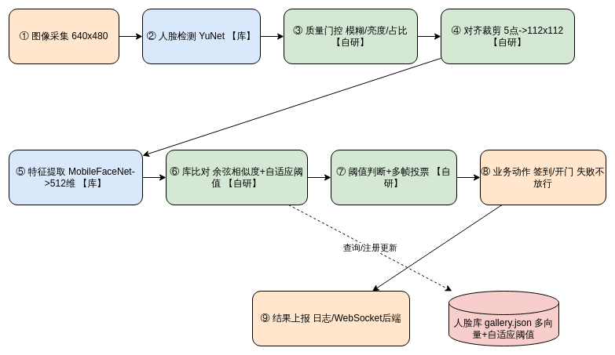

# 人脸识别流程说明

源文件：`人脸识别流水线.drawio`（可编辑）/ 导出图 `人脸识别流水线.png`

流程图覆盖任务书要求的七个环节，图上每个方框标注了 **【库】**（调用开源库完成）
还是 **【自研】**（本组自己实现或实质改进）。

---

## 一、识别流程（七步）

每一步的输入、输出与判定依据如下。判定依据一律给出具体取值，
取值来自本组在自建数据集上的标定实验（见《05-测试报告》）。

| # | 环节 | 输入 | 输出 | 判定依据 | 来源 |
|---|---|---|---|---|---|
| 1 | **图像采集** | 摄像头视频流（ov5647 CSI / USB） | 单帧 BGR 图像，640×480 或手机原图 | 相机采集帧率 20 FPS，编码 BGR888 | 库 |
| 2 | **预处理** | 原始帧 | ① 长边归一化帧 ②（暗光时）CLAHE 增强帧 ③ 112×112 对齐人脸 | ① 长边 > 1280 px 才等比缩小，只缩不放 ② 仅主检测无结果时才做 CLAHE（Y 通道，clipLimit=2.0，8×8 格） ③ 5 点关键点 → 相似变换，内点数 ≥ 3 | **自研** |
| 3 | **人脸检测** | 预处理帧 | 人脸框 (x,y,w,h)、5 点关键点、置信度 | 主检测器置信度 ≥ 0.6，NMS = 0.3 回退检测器置信度 ≥ 0.45 回退链内部重叠框按 IoU ≥ 0.35 去重 **质量门控**：拉普拉斯方差 ≥ 60、人脸区均灰度 40–220、人脸占比 ≥ 2% | 库 + **自研** |
| 4 | **特征提取** | 112×112 对齐人脸（BGR） | 512 维浮点特征向量（L2 归一化） | 确定性映射，无阈值；输入按 insightface 约定归一化到 [-1,1] | 库 |
| 5 | **比对 / 分类** | 512 维向量 + 人脸库 | 最相似对象的 user_id 与余弦相似度 | 余弦相似度（向量已 L2 归一化，等价于内积） 每人可存多个注册向量，取其中的最大值 | **自研** |
| 6 | **阈值判断** | 相似度、阈值 | confirmed / pending / unknown / lost 四态 | 全局拒绝阈值 0.30；每人自适应阈值 clamp(注册向量两两相似度的 mean − 2σ, 0.35, 0.55) 多帧投票：7 帧滑动窗口内同一身份占比 ≥ 70% 才确认 | **自研** |
| 7 | **业务动作** | confirmed 结果 + 授权名单 | 舵机开门（20 秒自动关）、WebSocket 上报后端 | 仅 `confirmed` 且姓名在授权名单内才开门 相似度不足或未注册 → **不放行**，留陌生人截图 人脸消失立即清空投票窗口 | 库 + **自研** |

---

## 二、注册流程

注册与识别共用第 2–4 步，区别在于末端不做判定而是写库。

| # | 环节 | 输入 | 输出 | 判定依据 |
|---|---|---|---|---|
| 1 | 采集 | 摄像头实时画面 | 5 张不同角度的人脸裁剪 | 按提示依次正视 → 左转 → 右转；只采通过质量门控的帧，抓拍间隔 1 秒 |
| 2 | 预处理 + 检测 | 同上 | 112×112 对齐人脸 | 同识别流程第 2–3 步 |
| 3 | 特征提取 | 对齐人脸 | 512 维向量 | 同识别流程第 4 步 |
| 4 | 写入人脸库 | 特征向量 | `data/gallery.json` | 同一 user_id 下追加向量；写入时重建比对矩阵并重算该用户的自适应阈值 |

**注册照的挑选**：数据集评测场景下，优先采用人工挑选的注册集目录；
数量不足 5 张时，从其余照片中按 `检测置信度 × √人脸占比` 排序补足。
被选作注册照的照片会从测试集中移除，避免注册集与测试集重叠。

---

## 三、关键设计取舍

**为什么把"质量门控"放在检测之后、特征提取之前。**
模糊或过暗的人脸送去提取特征，不仅算力白花，还会产生一个"看起来正常"的向量，
在库里随机匹配到某个相似度不低的人，造成误识。放在前面拦掉，既省算力又降误识。
消融实验证实：关掉门控后覆盖率从 89.5% 升到 94.7%，但代价是 2.6% 的误识。

**为什么识别场景只取检测置信度最高的一张脸。**
会议室签到是一人一门的场景，多人同框时按位置裁剪需要额外的跟踪逻辑。
当前 `top_k = 1`，多人同框只处理置信度最高者；这是已知局限，见测试报告的局限一节。

**为什么拒绝比误识更"便宜"。**
门禁场景下放错人（误识）的代价远高于让本人多刷一次（拒识）。
因此阈值和投票规则都偏向保守：宁可拒识，不轻易放行。
